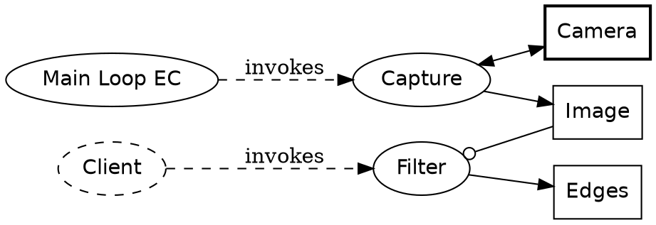
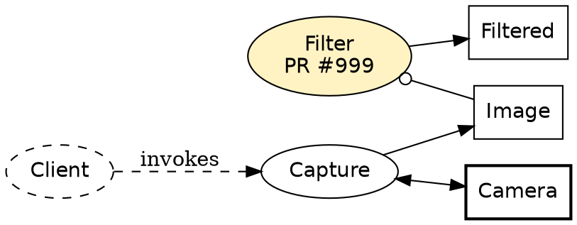

# juiz と OPM の対応

- 状態: 案(2026-11-06)。決めたことは [docs/decisions/](../docs/decisions/) に記録し、この文書に反映する
- 議論の元: プロジェクトの文書「juiz-OPM mapping」(2026-11-06)
- モデルが持つものの正確な定義は [metamodel.md](metamodel.md)。この文書は読み方と描き方の説明

## 1. 目的と範囲

juiz の設計と実装状況を、OPM(Object-Process Methodology, ISO 19450)の記号と文で描けるようにするための対応の決めごとです。

- 目的: 設計の相談、実装状況の共有、仕様書や issue に添える図を、同じ読み方で描くこと。モデル情報を道具の間で交換すること。
- 対象: Process、ContainerProcess、Container、接続(inlet・outlet、pull・push)、Topic、Composition、EC、ブローカーと System、Transformations。
- 使う OPM の範囲: Object・Process・State・手続きリンク・構造リンク・in-zooming・unfolding・OPL。細かい規則(条件リンク、例外リンクなど)は必要になった時に足す。
- 書き方の前提: 正本は文(OPL)とし、図はそこから描く([0002](../docs/decisions/0002-open-points.md))。

## 2. OPM の要点

OPM は「もの(Object)」と「こと(Process)」の 2 種類だけで系を表し、Process は必ず Object を使う・変える・生じる・消費するのどれかでつながる。この文書で使う記号は次のとおり。

| 要素 | 記号 | OPL の文の形 | 意味 |
| --- | --- | --- | --- |
| Object | 四角 | A is an object. | 存在するもの。情報(影なし)か物理(影あり) |
| Process | 楕円 | P is a process. | Object を変換すること |
| State | Object 内の角丸四角 | A can be s1 or s2. | Object が取りうる状態 |
| instrument | 白丸の端 | P requires A. | 変えずに使う |
| agent | 黒丸の端 | H handles P. | 人が動かす |
| consumption | Object→Process 矢印 | P consumes A. | 使い切る |
| result | Process→Object 矢印 | P yields B. | 新しく生じる |
| effect | 両端矢印 | P affects A. | 中身を変える |
| 状態変化 | State から Process、Process から State | P changes A from s1 to s2. | どの状態からどの状態へ |
| 集約 | 黒三角 | W consists of A and B. | 全体と部分 |
| 属性 | 三角の中に三角 | A exhibits X. | 持ち物・性質 |
| 分類 | 白三角 | B is an A. | 一般と特殊 |
| 例示 | 三角の中に黒丸 | b is an instance of B. | 型と実体 |
| in-zooming | 大きな楕円の中に子 | P zooms into P1 and P2, in that sequence. | Process の中身と順序 |

図(OPD)と文(OPL)は一対一で、どちらからももう一方を作れる。

## 3. 対応表

中心の対応は「Process は OPM の Process、Container は OPM の Object」。引数と戻り値も Object として図に出し、Process 同士を直接つながないのが OPM の流儀。用語は juiz の MOTIVATION.md と docs/spec/ に合わせている。

| juiz | OPM での表し方 | OPL の例 | 補足 |
| --- | --- | --- | --- |
| Process(純粋) | Process(楕円) | Increment is a process. | 冪等なので effect リンクを持たない |
| 引数(inlet) | 情報 Object + instrument | Increment requires Arg. | consumption ではなく instrument。inlet の値は実行後も残るため |
| 戻り値(outlet) | 情報 Object + result | Increment yields Count. | Process は値を 1 つだけ生じる |
| データ型(juiz.datatype) | Object の分類 | Count is an Int64. | 引数や戻り値の Object を型の特殊化として描く |
| inlet のキャッシュと p_apply | inlet Object の属性 + effect | P Apply affects Arg. | 既定値は Arg の属性 Default Value |
| Container | Object(部品に対応すれば物理) | Camera is a physical object. | 中身は属性か State。I/O の置き場 |
| ContainerProcess(書き込み) | Process + Container への effect | Capture affects Camera. | 状態を変えるなら changes ... from ... to |
| ContainerProcess(readonly) | Process + Container への instrument | Read Pose requires Arm. | readonly かどうかが線の端で見分けられる |
| Process / Container の型と実体 | 分類と例示 | inc0 is an instance of Increment. | 普段は実体だけ描き、型は必要な時だけ |
| 接続(outlet→inlet) | 共有する Object | P1 yields Image. P2 requires Image. | Object が接続そのもの。線は Process 同士を結ばない |
| push 接続 | 上記 + invocation リンク P1→P2 | P1 invokes P2. | 実行の連鎖の向きを稲妻矢印で |
| pull 接続 | 上記 + instrument 線に pull の印 | P2 requires Image (pull). | [0002](../docs/decisions/0002-open-points.md) の 1 |
| call / execute(外から) | 環境 Process(破線)からの invocation | Client invokes Increment. | 人が呼ぶなら agent |
| Topic | 情報 Object。publish は result、subscribe は event リンク | Talker yields Chatter. Chatter triggers Listener. | 受け手は Topic を知るだけで送り手を知らないことが図に出る |
| CompositeProcess | in-zooming | Pipeline zooms into Capture, Filter and Detect, in that sequence. | 外からは 1 つの Process、中を開くと子 |
| CompositeContainer | スロットを集約で | Robot consists of Base and Arm. | 実体は既存 Container への参照 |
| EC(main_loop_ec, one_shot_ec) | 状態機械とタイマー。EC は State stopped・started を持つ Object、周期の Process(Cycle)が started のときだけ動き bind した Process を invocation | Main Loop EC can be stopped or started. Cycle requires started Main Loop EC. Cycle invokes Capture. Cycle invokes itself. | main_loop は Cycle が自分を起こし、one_shot は Cycle が EC を stopped に戻す。周期は EC の属性 Rate。詳細は [metamodel.md](metamodel.md) §9.5 |
| System | 最上位の Object(SD の根) | System consists of Camera and Arm. System exhibits Capture. | 副系は集約で。別 System は別の OPD |
| ブローカー(HTTP, QUIC, IPC) | call の instrument になる Object | Remote Call requires HTTP Broker. | 配置の図は OPM の外([0002](../docs/decisions/0002-open-points.md) の 3) |
| ネームスペース・ID | 属性 | Arm exhibits Namespace. | 普段は描かず、名前に robot1/arm と書く |
| ContainerPose | Container の属性 | Arm exhibits Pose. | 全 Container が持つので必要な時だけ描く |
| Transform | 親と子を結ぶ Object(値を持つため) | Base-Arm Transform relates Base to Arm. | 値が要らない図なら名前付きの構造リンクでよい |
| Anchor | Container の特殊化 | World is an Anchor. Anchor is a Container. | 更新は Pose Update が木の Pose を affect |

## 4. 例

カメラ画像にフィルタを掛ける小さな System。Capture は Camera に結びついた書き込み ContainerProcess、Filter は純粋 Process、Main Loop EC が Capture を周期で起こし、外の Client が Filter を call する。名前は説明用で、実際のサンプルではない。

```text
Camera is a physical object.
Image and Edges are informatical objects.
Main Loop EC invokes Capture.
Capture affects Camera.
Capture yields Image.
Filter requires Image.
Filter yields Edges.
Client invokes Filter.
```



Image が Capture と Filter の間に立つことで、接続が「どの値を渡しているか」として見える。Camera への線が両矢印か白丸かで、書き込みか readonly かが分かる。

## 5. 実装状況の表し方

OPM には実装状況の記法がないので、塗りの色で表す。破線は OPM で「系の外(環境)」を表すので、状況には使わない。

| 状況 | 塗り | ラベルに足すもの |
| --- | --- | --- |
| 公開済み | なし(白) | なし |
| main に入ったが未公開 | 薄い緑 | なし |
| 作業中(PR あり) | 薄い黄 | PR 番号 |
| 計画のみ(issue あり) | 薄い灰、文字も灰 | issue 番号 |
| 不具合あり | 薄い赤 | issue 番号 |

## 6. 描画(Graphviz)

OPM の線の端は Graphviz の矢印の形でほぼ表せ、`dot -Tsvg` ですぐ画像になる。



State を Object の中に描くときは HTML ラベルの表で入れ子にする。稲妻矢印(invocation)や OPCloud と同じ見た目は再現しきれないので、ラベルで補う。

## 7. 全単射の確認

juiz-OPL と juiz の構成の間は、扱う範囲と正規形を決めれば全単射にでき、往復テストで機械的に確かめられる。juiz-OPL と標準の OPM の間は全単射にはならないので、「juiz-OPL からタグを落とすと正しい標準 OPL になる」ことを確かめる。

| 写像 | 全単射か | 崩れる理由 | 対策 |
| --- | --- | --- | --- |
| OPL の文 ⇔ OPM モデル(要素と線) | 正規形なら成り立つ | 文の並べ替え、「A and B」のまとめ、同じ事実の重複 | 1 文 1 事実と文の並び順を決めた正規形を定義する |
| OPM モデル ⇒ 図(OPD) | 図への片道だけ | 配置や図の分け方は文にない | 図はモデルから描くだけにし、図から文は作らない |
| juiz-OPL ⇔ 標準 OPM | 成り立たない | pull・push・Topic・readonly などのタグが標準にない。標準の多くの形(値を 2 つ生じる Process、consumption など)が juiz にない | juiz-OPL を「標準 OPL の部分集合 + タグ」と定義し、タグを落とす写像が意味を保つことを確かめる |
| juiz-OPL ⇔ juiz の構成 | 範囲を限れば成り立つ | 本体のコード、言語、ブローカーの設定は OPL にない | 範囲を conf と profile_full で見える構成に限り、両側に正規形を決める |

範囲(案): Process・Container・ContainerProcess の実体と型名、引数名と型、接続(push・pull)、Topic の publish・subscribe、Composite、EC と bind、Transform と Anchor、namespace。範囲外は本体のコード、言語、ブローカー設定とポート、.juizapp の配布情報。

確かめ方(証明ではなくテストによる確認):

1. 文法(EBNF)、整形式の規則、正規形を仕様に書く。
2. 往復テスト: OPL→モデル→OPL、conf→OPL→conf、OPL→conf→OPL が、正規化した上で一致すること。
3. サンプル 4 リポジトリの conf と、動いている System の profile_full をすべて通す。
4. 乱数で作ったモデルでの性質テスト(proptest)。
